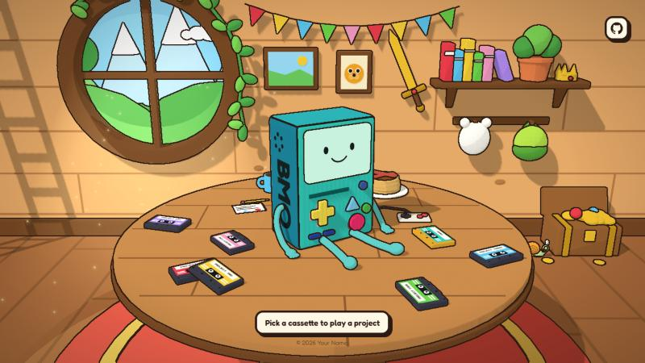

# BMO Portfolio

An interactive 3D portfolio template. BMO sits on a table in the tree house and your projects are cassettes scattered around it: pick one up, BMO loads it and shows the project on its screen.



## Features

- **Cassettes are projects.** Click one and it flies into BMO; the project shows up on its screen with a details panel next to it.
- **BMO reacts.** Every button on BMO is clickable and triggers a different reaction.
- **A playable mini game.** The golden cassette runs Snake on BMO's screen. Play with the arrow keys, WASD, the on-screen pad or BMO's own D-pad.
- **Hidden surprises.** A snail hides somewhere different on every visit, and a couple of things on the wall react when poked.
- **Cartoon look.** Toon shading with screen-space ink outlines.
- Works on desktop and mobile.

## Getting started

```bash
npm install
npm run dev
```

To create a production build in `dist/`:

```bash
npm run build
```

## Make it yours

| What | Where |
| --- | --- |
| Projects (title, tagline, description, tags, colour, links) | `src/data/projects.js` |
| Links in the top right corner | `SOCIALS` in `src/components/Hud.jsx` |
| Name in the footer | `src/components/Hud.jsx` |
| Page title | `index.html` |
| Where the cassettes lie on the table | `SLOTS` in `src/components/scene/Scene.jsx` |

Up to 8 cassettes fit on the table. The entry with `kind: "game"` in `projects.js` is the Snake cassette; delete it if you don't want the game.

## 3D models

The models in `public/models/` are exported from `blender/portfolio-scene.blend`. They are generated by the scripts in `blender/scripts/`, so the easiest way to change BMO, the snail or the hat is to edit the script and run it again from the repository root (with the file closed in Blender):

```bash
blender -b blender/portfolio-scene.blend --python blender/scripts/build_bmo.py
blender -b blender/portfolio-scene.blend --python blender/scripts/build_easter_eggs.py
```

Each run rebuilds those objects from scratch and re-exports the `.glb` files, so manual edits to them inside Blender are overwritten. Tested with Blender 5.2.

## Built with

[React](https://react.dev), [Vite](https://vite.dev), [three.js](https://threejs.org), [react-three-fiber](https://github.com/pmndrs/react-three-fiber), [drei](https://github.com/pmndrs/drei) and [Tailwind CSS](https://tailwindcss.com). Fonts are Fredoka, Luckiest Guy and Press Start 2P from Google Fonts.

## License

The source code in this repository is released under the [MIT License](LICENSE).

The MIT License does **not** cover the _Adventure Time_ visuals. It grants no rights to BMO, to other characters of the show, or to the show's setting and artwork. That applies to everything in this repository that depicts them, in particular:

- the 3D models in `public/models/`
- the Blender scene `blender/portfolio-scene.blend`
- the screenshot `docs/screenshot.jpg`
- the character and set designs reproduced by the scripts in `blender/scripts/` and by the scene components in `src/components/scene/` (the code itself is MIT, the designs it draws are not)

Those remain subject to the rights of their owners, see the copyright notice below. Third-party dependencies and fonts keep their own licenses.

## Copyright notice

BMO and _Adventure Time_ are trademarks and copyrighted works of Cartoon Network (Warner Bros. Discovery). This is an unofficial, non-commercial fan project. It is not affiliated with, endorsed by or sponsored by Cartoon Network or Warner Bros. Discovery.

The 3D models, scene and code in this repository were made from scratch for this project, but the BMO character and the _Adventure Time_ setting they depict belong to their owners. Please keep that in mind when you use this template:

- The MIT License lets you use the code commercially, but it cannot give you rights to the show. Do not use the template commercially or present it as an official product while it contains BMO or other elements of the show.
- If you need a commercial or client-facing site, replace BMO and the show-specific artwork with original characters of your own.

If you are a rights holder and want something removed, please open an issue.
